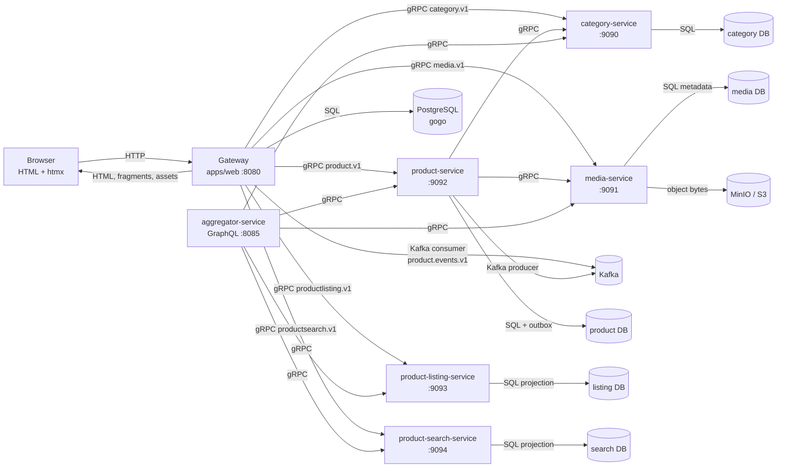
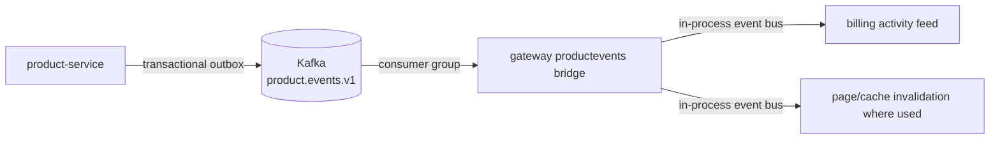
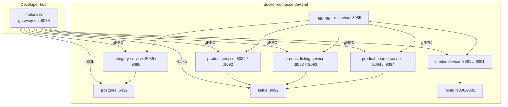
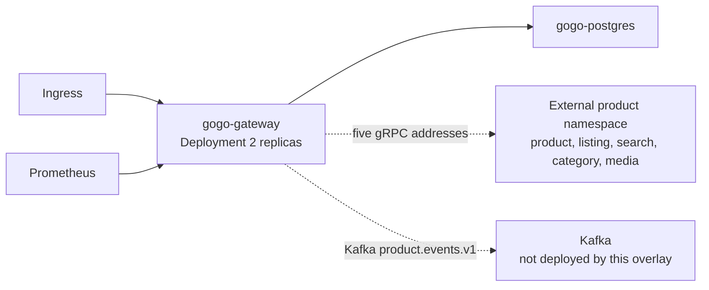

# Architecture, Coupling, Ownership, and Team Topologies Audit

**Status:** Phase 1 assessment complete. Findings are ready for review; no target-state implementation or application-code change has started.  
**Date:** 2026-10-20  
**Baseline:** repository revision `499473a` plus the uncommitted working tree  
**Scope:** the whole repository: gateway, six service modules, contracts, design system, assets, build, deployment, CI, UI surfaces, and ownership metadata.  
**Companion:** [`docs/architecture/current-state.md`](../current-state.md) records the Phase A discovery baseline. This report is the assessment of that baseline and supersedes `current-state.md` only for the findings, alternatives, and proposed sequence below.

> **Deliberate delay:** `target-state.md`, the ADRs, `team-ownership.md`, and `refactoring-plan.md` are not written in this phase. They depend on the ownership, release-ownership, and product-boundary decisions in Sections H and J. The task requires those decisions to be reviewed before the target documents are treated as approved.

## Contents

- [A. Executive summary](#a-executive-summary)
- [B. Method, scope, and baseline](#b-method-scope-and-baseline)
- [C. Current-state architecture](#c-current-state-architecture)
- [D. Boundary violation and gap register](#d-boundary-violation-and-gap-register)
- [E. Runtime and deployment topology](#e-runtime-and-deployment-topology)
- [F. Coupling and data-ownership matrix](#f-coupling-and-data-ownership-matrix)
- [G. UI ownership and presentation boundaries](#g-ui-ownership-and-presentation-boundaries)
- [H. Team Topologies and ownership assessment](#h-team-topologies-and-ownership-assessment)
- [I. Target-state alternatives and migration roadmap](#i-target-state-alternatives-and-migration-roadmap)
- [J. Fitness functions, decisions, and first increment](#j-fitness-functions-decisions-and-first-increment)
- [Appendix A. Evidence index](#appendix-a-evidence-index)
- [Appendix B. Document reconciliation notes](#appendix-b-document-reconciliation-notes)
- [Appendix C. Non-goals and rejected recommendations](#appendix-c-non-goals-and-rejected-recommendations)

## Evidence standard

This report separates three kinds of statement:

- **Observed:** read from the working tree or produced by a command.
- **Inferred:** follows from code structure or observed output, but is not directly asserted by a test or document.
- **Recommendation:** a proposed change; none of it has been implemented.

The working tree is part of the baseline because it contains substantial uncommitted work that is not in `HEAD`, including the native CMS builder. References to files therefore mean working-tree files, not necessarily committed files. No production system, database migration, deployment, or external service was modified.

The last full verification run in this assessment (`make check`) passed across the gateway and all six service modules. The fresh Go run reported 194 `ok` packages, 28 packages with no test files, and 0 failures. `make build`, `make docker-build`, the production CSS build, and the Compose smoke checks also passed. Those results are recorded in `current-state.md`; they are build/test evidence, not evidence that the deployment and ownership boundaries in this report are complete.

Two limits matter:

- The default gate skips live PostgreSQL and Kafka coverage when `CONTENTCMS_TEST_DATABASE_URL`, `POSTGRES_TEST_DSN`, and `KAFKA_TEST_BROKERS` are unset. A green suite is not proof of the event wire or live database behavior.
- There is no permanent browser, visual-regression, or accessibility suite. The CMS DOM controller has no browser-level coverage.

`make seed` is a separate local bootstrap failure: `.env` contains a password for the `gogo` database user that does not match the local development database. An explicit `DATABASE_URL` with the local credentials seeds successfully, and both demo accounts were verified against the running gateway. This is an environment-reproducibility issue, not a failure of the architecture gate.

---

## A. Executive summary

### A.1 Bottom line

The code is already a **modular monolith with team-owned verticals**, not a blank application that needs a new architecture. The code-level boundaries are substantially better than the repository's operational boundaries:

- Vertical packages are closed by architecture tests.
- The gateway is the only composition root.
- Product data has one authority: the platform services.
- The platform services have independent `go.mod` files and are tested with `GOWORK=off`.
- The design system, contracts, templ rendering, and htmx model are coherent with the current scale.

The highest-impact gaps are not missing framework features. They are gaps between what the repository claims and what it can enforce or operate:

1. **Ownership is declared, not operational.** The team catalog is gateway-only, uses placeholder teams T1–T5, and does not cover the six service modules, contracts, deployment, or CI. There is no root `CODEOWNERS`. Nobody can be routed a review or an incident from the repository metadata.
2. **The six service modules are build/test units but not release units in this repository.** CI tests all six through `make check`, but only the gateway image is built and published, only the gateway and PostgreSQL are in the Kubernetes overlay, and the explicit CI service loop names four of the six modules.
3. **The contract copies have no drift gate.** The root `contracts/` tree is gated with `buf`; service-local vendored protos and generated code are not. The aggregator's copies are already semantically behind the root contracts, while the other service copies match semantically.
4. **There are two competing local environment definitions.** `make up` uses `docker-compose.dev.yml`; the root `docker-compose.yml` still names retired `*-app` services and a shared `ecommerce_default` network. The repository's front door gives contradictory instructions.
5. **T5 is doing two different jobs.** It is labelled the platform team but also owns content CMS, billing, and ops. That is a platform-team charter and a product-stream charter in one placeholder. The CMS route also crosses T3's `/` ownership.
6. **Feature-specific CMS UI lives in shared assets.** The page-builder controller and builder CSS are in `shared/web/assets`, not under `features/contentcms`. The pure state core has Node tests; the 2,828-line DOM controller and the editor's browser behavior have no browser gate.

The right response is **tighten and make explicit**, not extract more services. The repository has not accumulated evidence for a new service boundary. The current in-process gRPC seams for auth, inventory, and sales are deliberate and tested; they should remain available without being exercised prematurely.

### A.2 Readiness scorecard

| Dimension | Assessment | Reason |
| --- | --- | --- |
| Compile-time modularity | **Strong** | Closed verticals; shell composition; no cross-feature compile edges; import graph is committed and freshness-tested |
| Service build independence | **Strong** | Six independent `go.mod` files; Make targets use `GOWORK=off`; services have their own tests |
| Service release independence | **Weak** | No service image publication, no service Kubernetes manifests, and only a gateway image in CI |
| Contract integrity | **Partial** | Root `buf` gate is strong; vendored copies are unguarded and the aggregator has drifted |
| Data-boundary integrity | **Partial** | Table ownership is clear in the gateway; product tenancy is a known upstream gap; merchant visibility is a known product decision |
| UI ownership | **Partial** | Most surfaces are correctly vertical-owned; CMS assets and the `/` composition are not fully represented |
| Team ownership | **Weak** | Placeholder IDs, incomplete catalog, no `CODEOWNERS`, no service owners |
| Deployment truth | **Weak** | Dev compose, root compose, CI, and Kubernetes describe different systems |
| Test and quality gates | **Good but uneven** | Strong Go/architecture/contract gate; missing browser, a11y, CSS-drift, service-image, and vendored-contract gates |
| Documentation accuracy | **Weak** | The README and architecture reference generalize the page/module model and undercount the platform services |

### A.3 Recommended direction

**Keep the modular monolith and the six service modules. Make the seams explicit and verifiable before adding any new boundary.**

That means:

- Keep the gateway as one deployable web application.
- Keep auth, inventory, sales, contentcms, billing, and ops in-process for now.
- Keep the product platform as five gRPC services plus the separate aggregator.
- Keep templ, htmx, and Tailwind; no SPA, microfrontend runtime, or service-mesh expansion.
- Make ownership, release, and contract metadata complete before calling the target state "team-owned."
- Retire the legacy CMS renderer only through the narrow, behavior-preserving migration described in Section J.

### A.4 Proposed first increment

The smallest code change that reduces a real boundary violation without changing behavior is still **Increment 1: replace the legacy Builder.io `html/template` body with an equivalent typed templ component** in the legacy content read path. It is isolated, reversible, and does not touch routes, persistence, authentication, pricing, inventory, or order semantics.

Before that change, the uncommitted native builder should be committed **as-is** in a focused change. Otherwise the first refactor diff will mix new CMS functionality, generated assets, and the renderer migration, and reviewers will have no stable baseline.

The full proposed sequence is in Section I. The decision points are in Section J.

---

## B. Method, scope, and baseline

### B.1 What was inspected

| Area | Evidence inspected |
| --- | --- |
| Gateway composition | `apps/web/internal/shell/{di.go,units.go,site_page.go}`, `apps/web/cmd/server`, `go.work`, module registrations |
| Architecture enforcement | `apps/web/internal/architecture/*`, `import_graph.txt`, `team_catalog.json`, service-local `internal/architecture` tests |
| Vertical boundaries | `apps/web/internal/features/*`, `OWNERS.md`, compose packages, cross-feature imports |
| Data authority | Gateway migrations, platform-service migrations, outbox and Kafka consumers, tenant handling |
| Contracts | `contracts/proto`, service-local vendored protos, generated packages, `buf` targets |
| Rendering and UI | templ sources, `presentation` packages, design-system module, `app.css`, page-builder JS/CSS |
| Runtime | `docker-compose.dev.yml`, root `docker-compose.yml`, `ports.txt`, `deploy/k8s`, Dockerfiles |
| CI and release | `.github/workflows/ci.yml`, Makefile, image tags, service Dockerfiles |
| Ownership | team catalog, per-feature `OWNERS.md`, Team Topologies PRD, decision records, documentation |
| Product scope | route table, handlers, empty states, README claims, current-state baseline |

### B.2 Commands and verification status

| Check | Status | Meaning |
| --- | --- | --- |
| `make check` | Passed in the assessment | Gateway vet/race tests, six service modules, gofmt, generated templates, `buf` lint/breaking, page-builder core tests, docs publication gate, team catalog |
| Fresh Go tests | Passed | 194 packages `ok`, 28 with no tests, 0 failures |
| `make build` | Passed | `bin/gogo` produced, templates and CSS generated |
| `make docker-build` | Passed | Gateway image built |
| `bun run css:build` | Passed | 274,038-byte `output.css`; all 83 `builder-*` classes present |
| Compose smoke | Passed with expected statuses | `/` 200, `/healthz` 200, `/readyz` 200, `/module-registry` 200, protected CMS routes redirect, unknown product 404 |
| Login and CMS smoke | Passed with explicit seed URL | Both seeded accounts authenticate; `penjual@toko.com` reaches seller and CMS; `pembeli@toko.com` is forbidden |
| `make seed` with `.env` | Failed | Local database password mismatch; explicit `DATABASE_URL` works |
| Browser/accessibility/visual regression | Not available | No permanent suite in the repository |
| Live PostgreSQL/Kafka default coverage | Skipped unless env vars are set | The green default gate is not live-wire proof |
| Kubernetes validation | Inspection only | `kubectl`/`kustomize` not installed; manifests not applied |

### B.3 Scope limits

- No real organization data was supplied. Team names and reviewer identities are not inferred from directory names.
- No production deployment, production database, payment provider, or customer account was touched.
- The product platform's upstream tenant gap is a documented external risk. It cannot be closed by changing gateway code.
- The absence of customer checkout, customer orders, shipping, and payment is a product-scope fact, not an architecture defect. The only implemented checkout is the seller POS.

---

## C. Current-state architecture

### C.1 System context



The aggregator is a separate GraphQL composition service. **The gateway does not call it**; no gateway code path imports or dials the aggregator. It has no database and is not in the Kubernetes overlay.

### C.2 Deployable and build units

| Unit | Module | Runtime endpoints | Owns data? | Build/test | Release/deploy in this repo |
| --- | --- | --- | --- | --- | --- |
| Gateway / web app | `apps/web` | HTTP `8080` | PostgreSQL `gogo`: auth, inventory, sales, contentcms tables | Yes | Gateway image built and published; Kubernetes manifests |
| Product service | `services/product-service` | HTTP `8082`, gRPC `9092` | `product` database; outbox | Yes, `GOWORK=off` | No image publish; no overlay |
| Product listing | `services/product-listing-service` | HTTP `8083`, gRPC `9093` | `listing` projection | Yes, `GOWORK=off` | No image publish; no overlay |
| Product search | `services/product-search-service` | HTTP `8084`, gRPC `9094` | `search` projection | Yes, `GOWORK=off` | No image publish; no overlay |
| Category | `services/category-service` | HTTP `8086`, gRPC `9090` | `category` database | Yes, `GOWORK=off` | No image publish; no overlay |
| Media | `services/media-service` | HTTP `8081`, gRPC `9091` | `media` database + object storage | Yes, `GOWORK=off` | No image publish; no overlay |
| Aggregator | `services/aggregator-service` | HTTP `8085`, GraphQL | None, by design | Yes, `GOWORK=off` | No image publish; no overlay |
| Contracts | `contracts` | Library | No | `buf` lint/breaking | Library module |
| Design system | `design-system/web/ui` | Library | No | templ generation, Go tests | Local replacement at `v0.0.0` |

`go.work` lists eight modules: design system, gateway, contracts, and the six service modules. Services are deliberately tested with `GOWORK=off`, so each is built on its own `go.mod` as it would be released. This is a good build boundary.

Terminology in this report: **five product-platform services** means product, listing, search, category, and media. **Six service modules** means those five plus the aggregator. The aggregator is a GraphQL composition layer, not a product-data authority.

### C.3 Composition reality versus the "federated module" claim

The repository uses "module federation" as a design metaphor. The implementation is more specific:

- `shell/units.go` has a **declared table** of six units: `billing`, `ops`, `home/ui`, `sales/ui`, `auth/ui`, and `profile/ui`.
- Only `billing` and `ops` are declared as `kindModule` and appear in the registry through that table.
- `auth`, `inventory`, and `sales` backend modules are registered as a side effect of resolving in-process gRPC connections. Their UI read-sides are pages.
- The running `/module-registry` contains five modules: `auth`, `inventory`, `sales`, `billing`, and `ops`.
- `contentcms` is mounted by a hard-coded `contentcmscompose.RegisterContentCMS(b)` call in `di.go`, outside the unit table. It is a top-level page, not a manifest module.
- `home`, `seller`, `auth`, and `profile` pages are mounted directly by the shell. They are not independently deployable units.

The architecture tests correctly enforce that only the shell imports verticals. They do not enforce that every vertical is represented in the unit table: `units_test.go` looks for a package-level function whose name is exactly `Register(*di.Builder)`, and `contentcms` exposes `RegisterContentCMS` instead. That is a real enforcement blind spot, not a runtime failure.

### C.4 Request and rendering lifecycle

```text
HTTP request
  -> middleware: metrics, request ID, real IP, tenant, logging,
     recovery, security headers, body limit, compression, timeout,
     navigation injection, published site settings
  -> page or module router
  -> application port
  -> infrastructure adapter (PostgreSQL, in-process gRPC, platform gRPC)
  -> typed presentation model (general pages)
  -> templ page/component
  -> layouts.Base (document) or render fragment (htmx)
  -> embedded output.css and JS
```

Public pages and the seller/account consoles use typed result models. The CMS document model is the deliberate exception: dynamic component properties are `map[string]any` because the component schema is user-authored. The domain validates and normalizes that map before save, publish, and render; ordinary pages do not receive database entities.

### C.5 Route ownership

| Surface | Route(s) | Runtime owner | Notes |
| --- | --- | --- | --- |
| Storefront home | `/`, `/?page=N`, `/?q=...` | shell dispatcher; `home/ui` fallback | `/` is shared with CMS home selection |
| Product detail | `/catalog/{id}` | `home/ui` | Reads listing projection + media |
| Search suggestions | `/search/suggest` | `home/ui` | Platform search |
| Login/logout | `/login`, `/logout` | `auth/ui` | Session cookie policy from shell |
| Profile | `/profile`, `/profile/pesanan`, `/profile/alamat`, `/profile/pengaturan` | `profile/ui` | Orders/address pages are placeholders; no customer commerce flow |
| Seller console | `/seller*` | `sales/ui` | Composes product/category, inventory, and sales contracts |
| CMS public page | `/pages/{slug}` | `contentcms/presentation` | Native published store first, legacy Builder fallback |
| CMS editor | `/admin/content/pages*`, `/admin/content/site*` | `contentcms/presentation` | Requires `authz.role.manage` |
| CMS preview | `/preview/pages/{slug}`, `/preview/site` | `contentcms/presentation` | Protected preview |
| Billing | `/billing`, `/billing/fragment` | `billing` | In-memory activity projection of product events |
| Ops | `/healthz`, `/readyz`, `/module-registry`, `/metrics`, `/debug/vars`, `/rum` | `ops` / shell | Readiness aggregates upstream breakers |
| Static assets | `/assets/*` | shared web assets | Embedded; no cache validators today |

### C.6 Data authority

| Data | Authority | Storage/access | Tenant handling |
| --- | --- | --- | --- |
| Product aggregate | `product-service` | Its own DB + outbox | **No tenant field in product contracts or migrations**; known upstream gap |
| Browse projection | `product-listing-service` | Its own DB, Kafka-fed | Derived from product; merchant field exists |
| Search projection | `product-search-service` | Its own DB, Kafka-fed | Derived from product; merchant field exists |
| Category hierarchy; merchant categories | `category-service` | Its own DB | Merchant categories are tenant-scoped via metadata; global hierarchy is shared |
| Media metadata and bytes | `media-service` | Its DB + MinIO/S3 | Media contract has merchant fields; bytes in object storage |
| Stock ledger | `inventory` feature | Gateway PostgreSQL | `(tenant_id, product_id)` and movement rows |
| POS sales | `sales` feature | Gateway PostgreSQL | Tenant-scoped transaction and item tables |
| Sessions, employees, roles, merchant memberships | `auth` feature | Gateway PostgreSQL | Tenant-scoped |
| CMS pages, revisions, published snapshots, site shell, submissions | `contentcms` feature | Gateway PostgreSQL | Tenant-scoped by page/site |
| Billing activity | `billing` feature | In-memory projection | Derived from product events; no ledger |
| Operational state | `ops` feature | Process state | No business data |

The gateway uses one PostgreSQL instance but separate table families per feature. That is a shared-instance, table-owned design. It is acceptable at the current scale, but it is not the same as independent databases: migrations, backups, and connection pools are shared operationally.

### C.7 Event flow



Product events are the only asynchronous cross-process business flow in the gateway. Within the platform, `product-service` publishes `product.events.v1`; the listing and search projections consume it. Auth, inventory, and sales use in-process gRPC over `bufconn`; they are not Kafka producers. The in-process bus is not a durable event log. Billing is explicitly an activity projection, not a financial ledger.

### C.8 Frontend and design-system shape

- Server-rendered templ pages; htmx swaps fragments.
- `layouts.Base` owns the document head, skip link, landmarks, header, footer, status region, and scripts.
- `PageShell` adds the narrow reading column and page spacing. Seller/profile use `Base` directly.
- Design tokens are generated from `design-system/tokens/tokens.json` into `design-system/web/tokens.css`.
- `output.css` is tracked and embedded, and is built from Tailwind v4 + DaisyUI + the design-system tokens.
- The native CMS has a Go component registry and a browser page-builder registry. The browser controller is in shared assets.

### C.9 Scope facts that must not be invented

The repository does **not** contain a customer cart, customer checkout, customer order, shipping, or payment flow. `/profile/pesanan` is an empty-state placeholder. The implemented checkout is the seller POS. Any target-state document that assumes a customer commerce flow is describing a different product.

---

## D. Boundary violation and gap register

The register uses four labels:

- **Breach:** code or metadata directly contradicts an ownership or data rule.
- **Enforcement gap:** the rule is stated but cannot be mechanically detected.
- **Operational gap:** the source boundary exists, but release/deploy/ownership does not follow it.
- **Drift:** two descriptions of the same system disagree.

### D.1 High-severity findings

**Baseline precondition (not a boundary violation):** the only native visual page builder exists in the uncommitted working tree. `HEAD` still contains the six old tracked files under `features/contentcms/ui`, while the working tree deletes them and adds the native domain, store, components, handlers, migrations, and page-builder JS. Until that work is committed as a focused baseline, any refactor diff mixes new functionality with boundary cleanup and reviewers cannot reproduce the starting point. This is a delivery risk, not a reason to reorganize the code.

#### V-01 · Product data has no tenant boundary

**Severity:** High · **Type:** breach (external, documented) · **Status:** open upstream

`ARCHITECTURE.md` D-011 records that the platform's product data has no tenant concept: product-service migrations carry no `tenant_id`, and the product, listing, and search contracts carry no tenant field. Gogo stamps a tenant on every call, but the authority ignores it for product rows. The observed contracts contain `merchant_id` but no tenant field. The result is that one tenant's products are visible to all tenants at the platform boundary.

This cannot be fixed in this repository. It is nonetheless the most consequential boundary risk in the assessment because it crosses the system's central data authority. Closing it requires an upstream contract and schema change, followed by a re-vendoring of contracts. Do not describe product data as tenant-isolated until that happens.

**Recommendation:** record this as an external dependency and an explicit product risk in the target state. Do not add a gateway-side workaround that gives the appearance of isolation without changing the authority.

#### V-02 · Ownership metadata does not cover the system

**Severity:** High · **Type:** enforcement and operational gap

Evidence:

- `apps/web/internal/architecture/team_catalog.json` has `"scope": "gateway"` and 14 units. T1–T5 are placeholders. T5 has seven units; T2 has three; T4 has three; T3 has one. There are no units under `services/`, `contracts/`, `deploy/`, or `.github/`.
- The catalog contains only three contracts: `inventory.v1`, `sales.v1`, and `auth.v1`. It does not model the product platform contracts or the aggregator's GraphQL surface.
- `contentcms` is represented only by `apps/web/internal/features/contentcms/presentation`, not its domain, application, infrastructure, compose, assets, or migrations.
- The six service modules have READMEs but no `OWNERS.md`. There is no root `CODEOWNERS`.
- T1 is described in Team Topologies documents as owning the catalogue, but has no gateway unit and no service-level reviewer entry.

**Impact:** review routing, incident escalation, and change approval cannot be derived from the repository. The catalog validates its own records, not the completeness of ownership. Adding real reviewers later will require a data migration, not a one-line edit.

**Recommendation:** expand the catalog in two scopes—gateway and platform—and add contracts, deploy, CI, and design-system units. Keep T1–T5 as placeholders until real identities are supplied. Never generate `CODEOWNERS` from placeholder IDs.

#### V-03 · Six services are not six release units

**Severity:** High · **Type:** operational gap

Evidence:

- `go.work` and each service's `go.mod` make the modules independently buildable. `make services-test` runs all six with `GOWORK=off`.
- `.github/workflows/ci.yml` builds and pushes only `ghcr.io/<owner>/gogo`. The Docker job uses the root Dockerfile; there is no service Dockerfile build or tag in CI.
- All six services have Dockerfiles, but no service image is published by this pipeline.
- `deploy/k8s/kustomization.yaml` deploys `namespace`, config, example secret, PostgreSQL, gateway, ingress, and network policy. It does not deploy product, listing, search, category, media, or aggregator.
- The gateway's Kubernetes deployment carries five platform addresses (`PRODUCT_ADDRESS`, `PRODUCT_LISTING_ADDRESS`, `PRODUCT_SEARCH_ADDRESS`, `CATEGORY_ADDRESS`, `MEDIA_ADDRESS`) that are expected to exist in another deployment pipeline.

**Impact:** "separately deployable" is true at the source/build level, not at the repository's release level. It is not possible to answer from this repository which artifact, version, owner, or rollout process serves the five addresses. The aggregator is a source-tested service with no production deployment path in this repository. This is an ownership and incident-response gap before it is a technical one.

**Recommendation:** make an explicit decision:

1. **External release:** the platform services are released by a separate pipeline/repository; this repository only vendors their source for local development. Then say so in the README, kustomization, and catalogue, and remove or clearly mark local images as non-production.
2. **In-repo release:** add service image builds, tags, and deployment manifests to this repository, with an owning team per service.

Do both only if there is a real reason. Do not leave the current ambiguity.

#### V-04 · Vendored contracts can drift, and the aggregator already has

**Severity:** High · **Type:** enforcement gap

The root `contracts/proto` tree is checked by `buf lint`, `buf generate`, and `buf breaking`. The services keep their own proto copies and generated packages so they build without the workspace. There is no check that those copies match the root contracts.

A semantic comparison (ignoring comments, `package`, and `go_package` options) found:

- `product-service`, `product-listing-service`, `product-search-service`, `category-service`, and `media-service` copies match the root contracts.
- `aggregator-service` copies are behind the root:
  - product: 28 normalized lines missing, including `ListProductTypes`, `product_type_id`, `schema_version`, `attributes`, and `merchant_id`;
  - category: 10 lines missing, including the merchant-category RPC and global flag;
  - listing: 5 lines missing, including product type, schema version, attributes, and merchant fields;
  - search: 4 lines missing, including product type, schema version, attributes, and merchant fields.

This is not necessarily a runtime failure: the aggregator may intentionally project a subset. But there is no recorded intent and no test that distinguishes "intentional subset" from "stale copy." The aggregator's GraphQL schema is consumer-facing, so an unrecorded projection is an API boundary risk.

**Recommendation:** generate all service copies from the root contracts, or add a drift test with an explicit allowlist for a genuinely narrower projection. Record the aggregator's subset as a contract decision, not an accident.

#### V-05 · Local environment definitions disagree

**Severity:** High (developer and operational onboarding) · **Type:** drift

- `Makefile` uses `docker-compose.dev.yml` for `make up`, `make up-platform`, `make down`, and the smoke checks.
- The root `docker-compose.yml` still dials `product-app`, `product-listing-app`, `product-search-app`, `category-app`, and `media-app`, and joins `ecommerce_default`. The dev stack uses `product-service`, `product-listing-service`, and so on.
- The root compose comment says the platform "runs from the repository root," but that platform is no longer a root stack.
- The root compose says "four product-platform services" in one comment and lists five addresses in another.
- `deploy/k8s/kustomization.yaml` repeats the four-service claim even though the gateway config sets five addresses.

**Impact:** a new maintainer following the repository front door can start the wrong stack or a stack that cannot resolve the gateway's dependencies. The authoritative dev topology is `docker-compose.dev.yml`; the root file is legacy. This does not affect the production gateway by itself, but it undermines the claim that the repository has one local topology.

**Recommendation:** declare `docker-compose.dev.yml` the only local topology. Replace the root file with a short pointer, or delete it after review. Add a check that the Make targets reference the intended compose file.

#### V-06 · T5 is both the platform team and a product-stream catch-all

**Severity:** High (Team Topologies) · **Type:** ownership mismatch

`team_catalog.json` labels T5 as `platform`, then assigns it:

- shell and composition,
- shared web and foundation,
- design system,
- content CMS,
- billing,
- ops.

A platform team is supposed to reduce extraneous load for stream-aligned teams, not own a content product, a billing activity surface, and operational endpoints as one charter. This is not an argument for inventing another team; there may not be headcount. It is an argument that the current five-team model is not a real organizational design.

The mismatch is visible at the CMS route: T5 owns the CMS, T3 owns the manual home page, and the shell's `publicSitePage` lets the CMS claim `/`. That is a cross-team interaction with no declared mode.

**Recommendation:** keep T5 as the platform provider for shell, shared web, design system, CI, and deployment. Give content CMS a named sub-charter or a real content team only when one exists. Record the T3/T5 `/` interaction explicitly: who approves a homepage switch, who owns the fallback, and which tests pin the precedence.

### D.2 Medium-severity findings

| ID | Finding | Evidence | Impact | Recommendation |
| --- | --- | --- | --- | --- |
| V-07 | CMS UI assets live in shared | `page-builder.js` and `page-builder-core.js` are under `apps/web/internal/shared/web/assets/js`; builder CSS is in the shared `app.css`; only the core has Node tests | Shared asset ownership becomes a dumping ground; every CMS asset change needs platform review; the global stylesheet carries feature-specific CSS | Move the JS/CSS under `contentcms` with an asset mount; preserve public URLs; add browser coverage |
| V-08 | `/` has two owners and one dispatcher | `shell/site_page.go` mounts `contentcms` and `home`, then arbitrates `/`; `team_catalog.json` has T3 home and T5 CMS but no `publicSitePage` unit | A CMS publish can change the storefront root; ownership of the route, precedence, and rollback is implicit | Add `publicSitePage` to the ownership map; document precedence and approval; add a test for CMS-home versus manual-home |
| V-09 | The unit table does not see contentcms | `di.go` calls `contentcmscompose.RegisterContentCMS(b)` outside `registeredUnits`; `units_test.go` only matches a function named exactly `Register` | The "every registering unit is declared" invariant is bypassed by naming; contentcms can be rewired without a table diff | Either expose a conventional registration entry or extend the table/invariant to direct units |
| V-10 | Documentation describes a different system | README says every feature module has a manifest and is independently deployable; it omits `/admin/content/*` and `/preview/*`, describes `/pages/{slug}` as Builder-only, and says four platform addresses while five are required. `ARCHITECTURE.md` still says "four contracts" in places. `make services-*` is described as four services although the Makefile lists six. | New maintainers and agents will implement against the wrong model | Correct the README, architecture reference, and kustomization comments; keep the PRD marked historical |
| V-11 | CMS authoring reuses the policy-administration permission | `contentcms/application/ports/page_store.go` defines `PageManagePermission = "authz.role.manage"` | An editor must be able to manage roles, or the deployment must use a policy administrator as the editor. There is no content-only permission | Introduce a dedicated `content.pages.manage` permission if the product needs non-admin editors; ask before changing authorization behavior |
| V-12 | Media has no architecture ratchet | `services/media-service` has no `internal/architecture` test; category, product, listing, search, and aggregator have one | The service with object-storage and metadata boundaries has no local import/architecture tripwire | Add a minimal architecture test for media's layers/ports, matching the other services |
| V-13 | Generated CSS and tokens can drift | `output.css` and `design-system/web/tokens.css` are tracked; `make check` regenerates them but does not fail on a changed tracked file. `app.css` still has `@source` entries for retired `internal/modules` and `internal/pages` | A local checkout can keep stale committed CSS; the Tailwind source list hides the current roots | Fail on `git diff --exit-code` for generated assets after a build; remove stale `@source` paths |
| V-14 | Developer tooling is not uniform | `make fmt` formats the gateway and design system only; `make tidy` runs only for the gateway; `gofmt-check` does cover all service modules | Contributors can leave service formatting/tidy drift that the test gate does not catch | Add `fmt`/`tidy` loops for every module, or rename the targets to state their scope |
| V-15 | Kubernetes configuration is not self-contained | The overlay deploys only gateway and PostgreSQL; `KAFKA_BROKERS: kafka:9092` has no Kafka Service in the overlay; the network policy expects Kafka at a product-namespace address; the kustomization comment says four platform services although five addresses are configured; the PostgreSQL manifest still carries logical-replication settings and a Debezium comment from the retired CDC path | A cluster deployment cannot be reproduced from this repository alone; the event feed may silently fall back to TTLs | Document the external prerequisites or add the missing manifests; align the Kafka address and comments with the actual deployment |
| V-16 | Browser behavior has no permanent gate | `page-builder.js` is 2,828 lines; only `page-builder-core.js` has Node tests; no browser, visual, or a11y suite exists | Responsive editor behavior, focus management, keyboard access, and regressions are verified manually | Add a small Playwright smoke/visual/a11y suite for the editor, homepage, product detail, and login; do not attempt full coverage first |

### D.3 Low-severity observations

| ID | Observation | Impact | Recommendation |
| --- | --- | --- | --- |
| V-17 | The design system is a local `replace` at `v0.0.0` | Independent versioning is nominal; a breaking change cannot be expressed as a version today | Keep the local module while there is one consumer; document co-release. Version it only when a second consumer needs a stable artifact |
| V-18 | Static assets lack validators | No `Cache-Control`, `ETag`, or `Last-Modified` on embedded assets | Add fingerprinting or validators when asset caching becomes part of the performance budget |
| V-19 | Page metadata is thin | `layouts.Base` supports one title and a site-wide description; no per-page canonical/social metadata | Introduce a typed metadata model when SEO is in scope; do not put arbitrary maps in layouts |
| V-20 | CMS handler is broad | `page.go` plus `editor_api.go` cover public rendering, editor APIs, preview, forms, revisions, and legacy rendering | Split along use cases only when touching them; do not do a speculative file split |
| V-21 | The Team Topologies PRD is historical | It still uses pre-D-023 paths and mentions a missing `team_catalog.yaml` | Keep its status banner; use `ARCHITECTURE.md` and this audit for current claims; do not treat its path table as a map |

### D.4 Accepted tradeoffs (not violations)

- **Auth, inventory, and sales communicate over in-process gRPC.** This is deliberate. It preserves a transport seam without paying for a network deployment. The tests exercise the seam; promote only on a named trigger.
- **The gateway uses one PostgreSQL instance for four features.** Table families and migrations are separated. This is a shared-instance modular monolith, not four independent data authorities. Revisit only for isolation, scale, or failure-domain reasons.
- **CMS component properties are dynamic.** A page builder needs schema-driven property maps. The validation boundary is the domain, not templ. Do not replace this with one Go struct per component.
- **Product-service has a richer outbox and contract set than the gateway needs.** The gateway consumes a projection. Do not mirror platform implementation details into gateway types.
- **The aggregator has no database.** Its architecture test and README enforce that. It is a composition layer, not a sixth product authority.
- **There are no customer orders or payments.** Their absence is not a boundary failure. Do not add them to an architecture refactor.

---

## E. Runtime and deployment topology

### E.1 Local topology



`make up` starts the Compose stack and waits for health checks. `make up-platform` starts everything except the gateway so `make dev` can run the gateway on the host with live templ/CSS watchers. The root `docker-compose.yml` is not this topology.

### E.2 Kubernetes topology as represented



The overlay has:

- namespace,
- shared ConfigMap,
- example Secret,
- PostgreSQL,
- gateway Deployment/Service,
- ingress,
- default-deny and allow rules.

It does not have the five product-platform services, the aggregator, Kafka, MinIO, or a schema-migration job. The gateway Deployment sets the five platform addresses explicitly. The ConfigMap comment and kustomization comment still describe four services; the runtime contract is five.

### E.3 Environment comparison

| Concern | `docker-compose.dev.yml` | root `docker-compose.yml` | Kubernetes overlay |
| --- | --- | --- | --- |
| Gateway | Gateway service, or host with `make dev` | Gateway service | Gateway Deployment |
| Database | `postgres` | `postgres` | `gogo-postgres` |
| Product platform | Six services in the Compose project | Not present; dials legacy `*-app` names on an external network | External product namespace |
| Kafka | Compose service | No producer/consumer stack | External/address-dependent; not in overlay |
| Object storage | MinIO | Not present | Not in overlay |
| Source of truth | Makefile targets | Stale comments and old service names | Gateway-only manifests |
| Readiness | Compose health checks | Assumes platform is elsewhere | Gateway probes `/readyz` |

### E.4 CI and release path

| Stage | What runs | What it proves | What it does not prove |
| --- | --- | --- | --- |
| `make check` | gofmt, templ generation, go vet, gateway race tests, all six service vet/race tests, `buf` lint/breaking, page-builder core, docs publication gate, team catalog | The source builds and the declared rules hold | Live database/Kafka behavior; browser behavior; service images |
| Explicit platform service loop | Build/test four named services: aggregator, product, listing, search | Those four modules are built on their own module graph | Category and media are not named in this redundant step (but are in `make check`'s six-service loop) |
| Docker job | Root image `gogo` only | Gateway image can build and publish | Six service images; aggregator image; deployment compatibility |
| Kubernetes | Manifests inspected, not applied | Declared resources | Actual cluster admission, external services, image availability, migrations |

The `make check` comment says "all six modules" and the Makefile's `SERVICES` list does contain all six. The explicit CI loop names four. That is a documentation and coverage clarity defect even though `make check` already covers the missing two.

### E.5 Deployment conclusion

The repository has a **single-service release pipeline** and a **multi-service source tree**. That is a legitimate intermediate state only if it is stated as such. Today the README, kustomization, and decision records imply a platform deployment that this repository does not produce. Either make the platform pipeline real or make the external ownership explicit. Do not add more service modules until that is resolved.

---

## F. Coupling and data-ownership matrix

### F.1 Compile-time and runtime coupling

Legend:

- `C` — compile-time import in the same Go module.
- `R` — synchronous gRPC or HTTP call.
- `K` — Kafka event.
- `D` — direct database access; the destination is the table owner.
- `S` — shared module/library dependency.
- `A` — deployment artifact edge.
- `·` — no direct edge.

| From \ To | shell | auth | inv | sales | home | CMS | billing | ops | platform | aggregator | contracts | design |
| --- | --- | --- | --- | --- | --- | --- | --- | --- | --- | --- | --- | --- |
| **shell** | C | C,R | C,R | C,R | C | C | C | C | R | · | S | S |
| **auth** | · | C | · | · | · | · | · | · | · | · | S | · |
| **inventory** | · | · | C | · | · | · | · | · | · | · | S | · |
| **sales** | · | · | R | C | · | · | · | · | R | · | S | · |
| **home** | · | · | · | · | C | · | · | · | R | · | S | S |
| **contentcms** | · | R | · | · | · | C | · | · | · | · | S | S |
| **billing** | · | · | · | · | · | · | C | · | K | · | S | · |
| **ops** | · | · | · | · | · | · | · | C | · | · | S | · |
| **platform services** | · | · | · | · | · | · | · | · | R,K,D | · | S (vendored copy) | · |
| **aggregator** | · | · | · | · | · | · | · | · | R | C | S (vendored copy) | · |
| **contracts** | · | · | · | · | · | · | · | · | · | · | C | · |
| **design system** | · | · | · | · | · | · | · | · | · | · | · | C |
| **deploy** | A | · | · | · | · | · | · | · | · | · | · | · |

Notes:

- The shell is the only gateway package that imports verticals. There is no cross-feature compile edge among auth, inventory, sales, home, contentcms, billing, and ops.
- The `platform services` row is a summary of five modules. Product calls category and media; listing and search consume Kafka; all own their own database. The aggregator calls all five.
- The deployment row is intentionally sparse: the Kubernetes overlay deploys the gateway and PostgreSQL only. The platform services are external to this deployment.

### F.2 Coupling heatmap

| Relationship | Coupling | Why it exists | Assessment |
| --- | --- | --- | --- |
| shell → all verticals | Compile + composition | Single binary; explicit unit table and DI | **Strong**, but table has a contentcms blind spot |
| sales UI → product/category/inventory/sales | Runtime contracts | Seller console composes four capabilities | **Acceptable**; one team owns the seller workflow, contracts isolate providers |
| home → product listing/search/media | Runtime contracts | Storefront read model | **Acceptable**; provider owns data |
| contentcms → auth | Runtime permission check | Editor authorization | **Acceptable but too coarse**: `authz.role.manage` |
| CMS → home `/` | Shell-mediated composition | CMS can own the site homepage | **Needs an explicit interaction contract** |
| gateway → platform | gRPC | Product authority outside gateway | **Strong**, except tenant gap and release ownership |
| product → category/media | gRPC | Write-time validation and media metadata | **Acceptable**; external platform internals |
| aggregator → five services | gRPC | GraphQL composition | **Acceptable**, but vendored contracts drift |
| services → contracts | Copy, not import | Independent module builds | **Intentional; needs a drift gate** |
| all UI → design system | Shared module | Consistent primitives | **Strong**; local `v0.0.0` versioning is nominal |
| deploy → gateway only | Deployment | External platform pipeline assumed | **Unresolved ownership** |

### F.3 Data ownership and transaction boundaries

| Transaction | Owner | Cross-boundary effect | Assessment |
| --- | --- | --- | --- |
| Product create/update/delete | product-service | Writes product DB + outbox; category/media validation | Single authority; tenant gap is upstream |
| Product projection update | listing/search services | Kafka consumption; rebuildable | Eventual consistency; no gateway writes |
| Stock adjustment | inventory | Atomic local rows; called by sales | Single writer; in-process gRPC |
| POS sale + stock movement | sales + inventory | Sales records transaction; inventory adjusts stock | Intentional composition; void path must be atomic/idempotent |
| Auth session/role change | auth | Policy rows and audit events | Single writer; CMS permission reuses policy permission |
| CMS draft/publish | contentcms | Pages, revisions, published snapshots | Single writer; public reads published snapshot only |
| Billing activity | billing | Product events → in-memory projection | Read model, not a ledger; no durable billing state |
| Aggregator query | aggregator | Read-only fan-out | No data ownership |

The sales/inventory pair is the most important in-process transaction boundary. It is not a distributed transaction across services; both modules are in one process and one PostgreSQL instance, but they communicate through a contract. Preserve the contract and the idempotency behavior when changing either side.

### F.4 Shared code boundaries

`shared` is substantial: HTTP middleware, render, module registry, DI, auth/product consumers, events, config, logging, and web assets. It does not import feature packages, and the architecture tests enforce that. That is the correct direction.

The pressure point is `shared/web/assets`: feature-specific page-builder JS and builder CSS now live there. A shared package can be a platform product; it should not become the default home for one feature's UI. The ownership rule should be: shared code is useful when the feature is deleted; page-builder code is not.

---

## G. UI ownership and presentation boundaries

### G.1 Ownership by surface

| Surface | UI owner | Backend/data owner | Cross-team interaction | Verdict |
| --- | --- | --- | --- | --- |
| Home, product detail, search | T3 Storefront | T1 product platform | T3 consumes contracts | Clear |
| Seller console | T2 Merchant Console | T2 inventory/sales; T1 product/category | T2 composes T1 contracts through its UI adapters | Clear; highest UI integration surface |
| Login/logout | T4 Identity | T4 auth | T5 shell provides cookie policy | Clear |
| Profile | T4 Identity | T4 auth | None material | Clear |
| Billing | T5 | T5 billing; T1 event feed | T1 event contract | Clear but T5 charter issue |
| Ops/health | T5 | T5 ops | T5 platform | Clear |
| CMS public page | T5 | T5 contentcms | T3 owns `/` fallback | **Ambiguous at root** |
| CMS editor | T5 | T5 contentcms; T4 permission | T4 authorization | **Coarse permission** |
| Shell/layout/nav | T5 | T5 shared | All verticals consume | Clear platform product |
| Design system | T5 | T5 design | All UI consumes | Clear, nominal versioning |

### G.2 What is working

- General pages use typed result models; they do not pass database rows into templ.
- The CMS exception is bounded and validated.
- The shell composes verticals; verticals do not import each other.
- `layouts.Base` provides landmarks, skip link, and a single document shell.
- The CMS editor uses `textContent`/DOM APIs rather than injecting authored HTML into the controller.
- The native CMS path uses one Go component registry and generated responsive CSS from validated inputs, not arbitrary Tailwind classes.

### G.3 UI ownership gaps

1. **Root route ownership.** `publicSitePage` is the only place that knows CMS precedence over the storefront home. It is not in the team catalog or `OWNERS.md`. Add it as a composition unit with a named owner and a testable precedence rule.
2. **CMS asset ownership.** The feature's JS/CSS are in shared. Move them under the feature or explicitly assign shared asset ownership to T5. If moved, preserve `/assets/...` URLs so no public contract breaks.
3. **Permission ownership.** CMS authoring is coupled to role administration. Decide whether content editing is a distinct permission and who can grant it.
4. **Page metadata.** The shell has no typed per-page metadata contract. This is a UI/SEO gap, not a reason to hand raw maps to templates.
5. **Tests.** The page-builder core is well tested; the DOM controller, responsive editor, keyboard behavior, and public CMS rendering are not browser-tested.

### G.4 UI alternatives considered

| Alternative | Result | Reason |
| --- | --- | --- |
| React SPA per vertical | Rejected | Adds runtime, hydration, bundle, and deployment complexity; templ/htmx already covers the interaction model |
| Microfrontend runtime | Rejected | The gateway is the composition root; HTML fragments are the integration contract |
| One shared component library with feature-specific slots | Rejected | Creates a slot registry and couples teams; the current narrow ports are better |
| Feature-owned assets with shared primitives | **Recommended** | Matches D-024 and the vertical ownership model without changing URLs |
| Shared assets for everything | Current state | Simple at first, but hides feature ownership and grows the global bundle |

---

## H. Team Topologies and ownership assessment

### H.1 Current team model

| Team | Declared type | Declared ownership | Actual code/operations | Fit |
| --- | --- | --- | --- | --- |
| T1 Catalogue | stream-aligned | Product platform services, contracts | `services/*`, product-family contracts, aggregator; no catalog unit in `team_catalog.json`; no `OWNERS.md` under services | **Partially represented** |
| T2 Merchant Console | stream-aligned | inventory, sales, seller UI | One vertical directory with backend + UI for the seller job | **Strong** |
| T3 Storefront | stream-aligned | home UI | `features/home/ui`; consumes product platform | **Strong**, but shares `/` with CMS |
| T4 Identity | stream-aligned | auth backend + login/profile | `features/auth`, `features/profile`; permission check for CMS | **Strong**, but CMS permission is too coarse |
| T5 Gateway Platform | platform | shell, shared, design system, contentcms, billing, ops | Platform substrate plus three product surfaces | **Overloaded** |

### H.2 Team Topologies diagnosis

**The boundary model is stronger than the team model.** The code has clear vertical boundaries, but the catalog conflates "unit" with "team" and omits the platform service units. The result is a false sense of completeness.

The main topology problems are:

1. **T5 has no single job.** Platform teams reduce cognitive load by providing self-service infrastructure. T5 also owns editorial content, billing activity, and operational health. Those have different customers, different failure modes, and different planning cadence.
2. **T1 is the largest declared owner with the least metadata.** Its charter implies the five product-family services plus the aggregator, but the catalog has no service entries and no service reviewers. The highest-volume domain is invisible to ownership checks.
3. **T2's seller UI is a cross-team composition.** That is correct stream-aligned design—one team owns the seller's end-to-end job—but its dependence on T1 contracts needs an explicit X-as-a-Service interaction, not just import rules.
4. **T3 and T5 share the storefront root.** The interaction is mediated by shell code, not by a declared team interaction. A CMS publisher can change the storefront home. That needs an explicit collaboration/X-as-a-Service decision.
5. **There is no ownership of the paved road itself.** CI, deployment, compose, docs, and root tooling are T5's by implication, but not represented as units. A platform team that owns the pipeline should be visible in the catalog that governs it.
6. **Placeholders are honest but empty.** T1–T5 are not real reviewers. No `CODEOWNERS` should be generated until real identities exist; a generated file with fake IDs would be worse than none.

### H.3 Team interaction modes

| Interaction | Declared/needed mode | Current evidence | Recommendation |
| --- | --- | --- | --- |
| T1 → T2/T3 | X-as-a-Service | Product contracts, breakers, read models | Keep; add contract drift gate |
| T2/T3 → T5 | X-as-a-Service | Shell, render, DI, design system | Keep; publish a clear platform interface |
| T1 ↔ T5 | Time-boxed collaboration | Client kits and contract plumbing | Record the collaboration boundary; converge to X-as-a-Service |
| T4 → T5 | Collaboration / X-as-a-Service | Session identity, permission checks | Keep; define CMS permission contract |
| T5 ↔ T3 at `/` | **Unclear** | `publicSitePage` dispatcher | Explicitly decide precedence, approval, and rollback |
| T5 CMS ↔ T4 auth | X-as-a-Service | Permission check | Add a content-specific permission if needed |
| T1 platform services ↔ deployment | **Unowned** | External Kubernetes addresses | Name the release owner and pipeline |

### H.4 Team-size and ownership cautions

No real organizational data was provided. Do not infer team size, reporting lines, or on-call rotations from directory names. The placeholder model describes **boundaries**, not people. The target documents should either:

- retain T1–T5 as placeholders with a documented substitution procedure, or
- use real team IDs and reviewer identities supplied by the user.

Creating a sixth team solely because T5 is overloaded would be fiction today. The honest interim is to separate **T5's platform charter** from **its content/product charter** in prose and in the catalog's unit grouping, while keeping the same placeholder ID. When a real content owner exists, promote that sub-charter to a team.

### H.5 Proposed ownership shape (for later `team-ownership.md`)

| Team boundary | Owns | Does not own |
| --- | --- | --- |
| Platform (T5) | shell, shared HTTP/render/DI/events, design system, CI, deploy, local topology, docs tooling | Editorial policy, storefront product decisions, seller business rules |
| Content/CMS (T5 sub-charter today, T6 if real) | contentcms domain, store, editor, public CMS rendering, site settings, page-builder assets | Platform shell, generic render, design system |
| Merchant (T2) | inventory, sales, seller UI, POS workflows | Product aggregate, category hierarchy, customer checkout |
| Storefront (T3) | home, product detail, search UI, storefront composition | Product data, CMS authoring |
| Identity (T4) | auth, sessions, roles, merchant memberships, login/profile | Business policy for product or content |
| Catalogue (T1) | product, listing, search, category, media, aggregator, product contracts | Gateway shell, seller UI, content CMS |

This shape keeps the number of real teams at five placeholders. It makes T5's overload visible rather than silently normalizing it.

---

## I. Target-state alternatives and migration roadmap

### I.1 Alternatives

| Option | Description | Advantages | Costs/risks | Verdict |
| --- | --- | --- | --- | --- |
| **A. Status quo plus documentation** | Keep code as-is; fix docs only | Lowest effort | Leaves ownership, release, and contract drift; does not answer the audit | Insufficient |
| **B. Modular monolith with explicit verticals and external platform release** | Keep gateway and in-process verticals; keep six service modules; make the platform pipeline/ownership explicit; add gates | Preserves behavior and performance; matches current code; resolves ownership ambiguity; no new runtime | Requires an ownership decision for services and real CI/deploy work | **Recommended target shape** |
| **C. Extract gateway verticals into services** | Turn auth/inventory/sales/contentcms into separate deployables | Independent scaling and failure isolation | Adds network, deploy, observability, data, and transactional complexity; no independent owners or triggers today | Not justified now |
| **D. Merge the gateway verticals into one package/module** | Reduce directory and module count | Fewer boundaries to explain | Destroys team ownership and service seams; recommends merging only to simplify a diagram | Rejected |
| **E. Microfrontends / React SPA** | Client-side composition per vertical | Independent frontend deploys | Contradicts templ/htmx model; adds runtime and a Node toolchain; not needed for current interactions | Rejected |
| **F. Platform services merged into gateway** | One deployable for everything | Simplest local run | Removes product platform authority and independent service lifecycle; contradicts D-018 | Rejected |

**Recommended target shape: Option B.** It is not a new architecture; it is the current architecture with its seams made explicit:

- one gateway deployable, five product-platform service modules, one aggregator, one design-system module, one contracts module;
- team-owned verticals inside the gateway, shell as the only composition root;
- product platform as an X-as-a-Service provider with a declared release owner;
- a content sub-charter inside T5, or a real content team when one exists;
- contract copies generated or drift-gated;
- feature assets under their feature;
- a release pipeline that matches the deployment claim.

### I.2 Target-state invariants

These are the conditions the target documents should preserve:

1. No cross-feature compile imports. Only the shell composes verticals.
2. `shared` and `contracts` never import feature packages.
3. The gateway remains the only web deployable; no new service is extracted without a named trigger.
4. Product data remains platform-owned; the gateway never writes product rows.
5. Inventory/sales remain the only stock and POS authorities; no duplicate ledger.
6. CMS public reads use published snapshots; drafts never leak to public routes.
7. URLs, HTML semantics, accessibility behavior, auth, pricing, inventory, and order semantics are preserved by every increment.
8. Generated `*_templ.go` and `output.css` are regenerated, never hand-edited.
9. Tailwind classes remain finite and build-verified; no runtime-generated class strings.
10. `team_catalog` and `CODEOWNERS` are derived from real identities, not invented.

### I.3 Proposed migration sequence

| Increment | Change | Risk | Blast radius | Gates |
| --- | --- | --- | --- | --- |
| **0** | Commit the existing native builder as-is; update the front-door docs to match the working tree | Very low | Git history and docs | `make check`; no code behavior change |
| **1** | Migrate the legacy Builder.io body from `html/template` + `templ.Raw` to equivalent typed templ components | Low | Legacy CMS read path only | Golden markup/escaping tests; `make check`; Compose smoke; rollback to old renderer |
| **2** | Expand ownership metadata: gateway units, service units, contracts, deploy/CI; decide real identities | Low | Docs/catalog only | Catalog validator; no `CODEOWNERS` until real IDs |
| **3** | Resolve the release/deployment story: external platform pipeline or in-repo service images/manifests; fix compose/k8s/docs | Medium | CI, deploy, onboarding | Build/publish per service; kustomize render; environment smoke |
| **4** | Add contract drift gate for vendored protos; document aggregator projection | Low/medium | Contract generation | `buf` drift test; generated-code diff; no API break |
| **5** | Move page-builder JS/CSS under `contentcms`; add CSS-drift and browser gates | Medium | CMS assets and editor behavior | URL preservation; Playwright smoke/visual/a11y; CSS diff |
| **6** | Introduce typed page metadata and formal `/` route ownership/interaction tests | Low/medium | Layouts/SEO and home/CMS precedence | Snapshot/HTML tests; route precedence test |
| **7** | Split the CMS handler and add dedicated content permission only if the product needs it | Medium | CMS APIs/auth | Authorization tests; no behavior change by default |

The sequence is intentionally front-loaded with reversible work. Increment 0 protects the only native builder before any refactor. Increment 1 is the smallest code boundary fix. Increments 2–4 resolve the largest governance and release risks before more UI work.

### I.4 Why not extract a service now

The repository has in-process seams, but no named extraction trigger has fired:

- auth, inventory, and sales have no independent release cadence;
- there is no independent owner for any of them;
- there is no access-policy or regulatory reason to isolate them;
- the current transaction boundaries benefit from one process and one database;
- the in-process gRPC contract already makes a future transport change narrow.

Extracting them now would convert a code boundary into a network and operational boundary before the team ownership exists. That is the wrong order.

### I.5 If a trigger fires later

Promote a vertical only when all of these are true:

1. A named team owns it independently.
2. It needs an independent release cadence or failure domain.
3. Its data can be separated without a distributed transaction.
4. The contract and operational support (metrics, tracing, on-call) are ready.
5. The gateway can degrade gracefully when it is unavailable.

The existing `bufconn` seam is the preparation for that day, not a reason to do it now.

---

## J. Fitness functions, decisions, and first increment

### J.1 Existing fitness functions

| Check | Enforces | Status |
| --- | --- | --- |
| `TestFeatureVerticalIsAClosedModule` / import graph | Vertical closure; only shell composes | Exists, passing |
| `TestImportGraphIsCurrent` | Committed import graph matches `go list` | Exists, passing |
| `TestImportBoundaries` | Shell is composition root; shared does not import app code; retired roots absent | Exists, passing |
| `units_test` | Declared units exist; registering units are declared | Exists, with contentcms blind spot |
| Service `internal/architecture` tests | Service layer/vendor boundaries | Exists for five of six modules; media missing |
| `buf lint` / `buf generate` / `buf breaking` | Root contracts | Exists, passing |
| `make services-vet` / `services-test` | All six service modules on `GOWORK=off` | Exists, passing |
| `page-builder-test` | Pure document/state behavior | Exists, 23 tests |
| `arch-team-catalog` | Catalog shape, paths, team IDs | Exists, gateway scope only |
| `docs-site-gate-test` | Legal publication gate | Exists |
| Compose smoke | Gateway routes/health | Exists in dev workflow |

### J.2 Proposed fitness functions

These are recommendations; none is implemented in this phase.

| Proposed check | Why | Failure example it prevents |
| --- | --- | --- |
| **Service matrix completeness** | The explicit CI list and the Makefile `SERVICES` list must agree | A service silently loses its only build gate |
| **Vendored contract drift** | Root contracts and service copies must match or be explicitly allowlisted | Aggregator silently loses fields/RPCs |
| **Service image manifest coverage** | Every deployable referenced by the platform addresses has an image/manifest owner | Five addresses with no reproducible artifact |
| **Generated asset diff** | `tokens.css` and `output.css` are reproducible from source | Committed CSS/tokens drift while the build stays green |
| **Route ownership test** | `/` precedence and public route set are pinned | CMS publish unexpectedly replaces the storefront home |
| **Unit-table completeness** | Any direct composition entry is declared, not only `Register` | `contentcms` changes outside the table |
| **Browser smoke/a11y** | Editor and representative public pages work in a real browser | Focus/keyboard/responsive regressions |
| **Kustomize/render check** | The overlay renders and its comments/addresses agree | Four-vs-five service drift; missing Kafka |
| **All-module tidy/format** | Service modules stay at the same hygiene level as the gateway | A service-specific go.mod drifts |
| **Ownership completeness** | Every unit in a declared scope maps to exactly one team | Orphaned service or asset |

### J.3 Decisions required before target docs and implementation

1. **Baseline:** Should the uncommitted native builder be committed as-is in a focused change before any refactor? *Recommendation: yes.*
2. **First code increment:** Is the legacy CMS templ migration approved as the first code change? *Recommendation: yes, after the baseline commit.*
3. **Ownership:** Should T1–T5 remain documented placeholders, or will real team/reviewer identities be supplied? *Recommendation: keep placeholders until real identities exist; do not fabricate `CODEOWNERS`.*
4. **Browser coverage:** Is a Playwright-style smoke/visual/a11y suite required for the target state, or is the current unit/integration gate sufficient for this phase? *Recommendation: at least a small browser smoke/a11y gate for the editor and public pages.*
5. **Service release ownership:** Are the five product-platform services and the aggregator released by this repository or by an external platform pipeline? *Recommendation: name one owner and one pipeline; do not leave the current ambiguity.*
6. **Product tenancy:** Who owns the upstream `tenant_id` work in product/listing/search contracts and migrations? *This is a business/platform decision, not a gateway refactor.*
7. **Merchant visibility:** Is the current all-merchants public storefront an accepted product decision, or should visibility be narrowed? *This changes behavior; ask before changing it.*
8. **CMS permissions:** Should content editing have a dedicated permission instead of `authz.role.manage`? *Recommendation: yes if non-admin editors are expected.*
9. **T5 charter:** Should CMS be a T5 sub-charter or a real content team when one exists? *Do not invent a sixth team now.*

### J.4 First increment in detail (proposed, not started)

**Goal:** remove the second rendering engine from the legacy Builder.io read path while preserving markup, escaping, accessibility, and URLs.

**Scope:**

- Define typed presentation models for the legacy editorial page and its blocks.
- Render the body with templ instead of `html/template` plus `templ.Raw`.
- Preserve the existing markdown behavior (Goldmark with raw HTML disabled), FAQ items, CTA links, images, and empty states.
- Keep the native CMS renderer untouched.
- Remove the `html/template` import and runtime template execution from the legacy content handler.
- Add tests for markdown safety, FAQ lists, CTA URLs, images, and empty content.

**Non-goals:**

- Do not change `/pages/{slug}` behavior.
- Do not change Builder.io configuration or fallback semantics.
- Do not change the native CMS document model.
- Do not change CSS, routes, auth, content storage, pricing, inventory, orders, or deployment.
- Do not split the CMS handler in this increment.

**Verification:**

- Golden HTML/escaping tests for the legacy body.
- Existing CMS handler tests and `make check`.
- Compose smoke for `/pages/{slug}` with Builder disabled and with a fixture if the test harness supports it.
- Manual or snapshot check that the rendered classes and landmarks are unchanged.

**Rollback:** revert the single commit; no schema or route migration is involved.

### J.5 What must not be done in the first increment

- No directory reorganization.
- No new service or module.
- No changes to product tenancy or merchant visibility.
- No change to the CMS permission model.
- No hand-edited generated files.
- No unrelated feature cleanup.
- No claim that the release/deploy story is fixed until it is.

---

## Appendix A. Evidence index

| Claim | Primary evidence |
| --- | --- |
| Eight Go modules | `go.work`; `go.mod` files |
| Six platform services and ports | `ports.txt`, `docker-compose.dev.yml`, each service's README |
| Gateway composition and unit table | `apps/web/internal/shell/{di.go,units.go,units_test.go}` |
| Root route composition | `apps/web/internal/shell/site_page.go` |
| CMS permission | `apps/web/internal/features/contentcms/application/ports/page_store.go` |
| Team catalog scope and units | `apps/web/internal/architecture/team_catalog.json` |
| No `OWNERS.md` under services or root `CODEOWNERS` | repository tree inspection |
| Import boundaries | `apps/web/internal/architecture/*.go`, `import_graph.txt` |
| Service architecture coverage | `services/*/internal/architecture/*`; media has none |
| Contract copies | `contracts/proto`, `services/*/proto`; semantic comparison in this assessment |
| Gateway-only CI image | `.github/workflows/ci.yml` Docker job |
| Gateway-only Kubernetes overlay | `deploy/k8s/kustomization.yaml`, `gateway.yaml`, `postgres.yaml` |
| Local topology conflict | `docker-compose.dev.yml`, root `docker-compose.yml`, Makefile targets |
| CMS assets in shared | `apps/web/internal/shared/web/assets/js/page-builder*.js`, `apps/web/internal/shared/web/assets/css/app.css` |
| Stale Tailwind sources | `apps/web/internal/shared/web/assets/css/app.css` lines 3–10 |
| Generated asset tracking | `git ls-files` for `output.css` and `design-system/web/tokens.css` |
| Native builder uncommitted | working-tree status; six deleted old `contentcms/ui` files and untracked replacement |
| No customer commerce flow | route table and profile/seller handlers; current-state baseline |
| Product tenant gap | `ARCHITECTURE.md` D-011 and D-018; product migrations/contracts |
| Merchant visibility | `ARCHITECTURE.md` D-021; seller/storefront handlers |

## Appendix B. Document reconciliation notes

- `current-state.md` remains the Phase A baseline. It correctly records the green build/test baseline, the dirty tree, the native builder, the CMS dual render path, and the ownership gaps.
- This report adds the service-release, vendored-contract, compose/kustomization, T5-charter, and route-ownership findings that are not fully developed in `current-state.md`.
- The Team Topologies PRD is explicitly historical. Its pre-D-023 paths should not be used as the current repository map. Its boundary doctrine and escalation ladder remain useful as requirements input.
- `README.md` and the architecture reference need a separate documentation correction after the target decisions; this audit does not edit them.

## Appendix C. Non-goals and rejected recommendations

The audit does not recommend:

- splitting auth, inventory, sales, contentcms, billing, or ops into services now;
- merging the five product-platform services or the aggregator into the gateway;
- replacing templ/htmx with React or a microfrontend runtime;
- adding Kafka to the in-process verticals for symmetry;
- adding a service mesh, a new API gateway, or a new workflow engine;
- creating a speculative module or package for a future feature;
- inventing team names, reviewer identities, or `CODEOWNERS` entries;
- changing pricing, inventory, authorization, payment, or order semantics as part of a refactor.

The recommended path is **Option B**: keep the working modular monolith, make the platform release boundary and team ownership explicit, retire the legacy CMS renderer through a narrow typed-templ change, and add only the gates that protect the seams that already exist.
